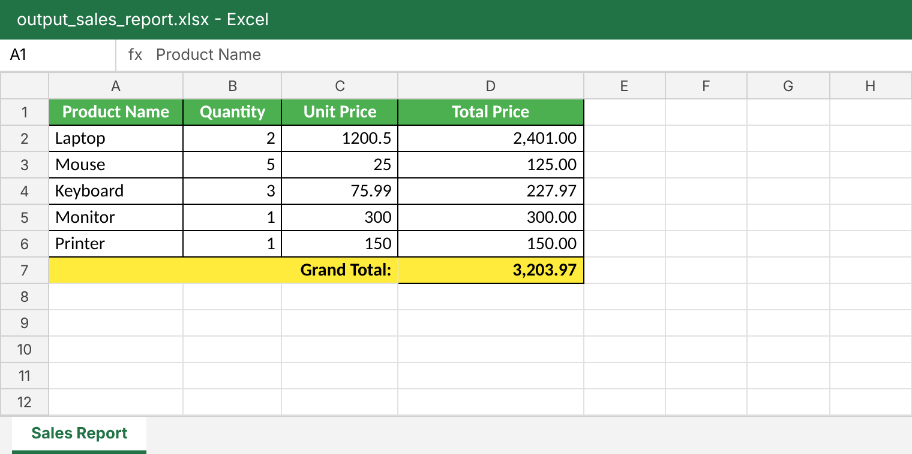

# Week 10 Lab Basic: Automating Spreadsheets (Excel & Google Sheets)

**ผู้จัดทำ:** นางสาวเมธาวี สิทธิชัยเนตร  
**รหัสนักศึกษา:** 663380372-6

## รายละเอียด
โปรแกรม Sales Data Processor ใช้ไลบรารี `openpyxl` จัดการไฟล์ Excel (.xlsx) ทำงานดังนี้
1. โหลดข้อมูลการขายจาก `data/input_sales.xlsx` (Product Name, Quantity, Unit Price)
2. คำนวณราคารวมของแต่ละรายการ (Total Price = Quantity × Unit Price) โดยข้ามแถวที่ว่าง
3. คำนวณยอดรวมทั้งหมด (Grand Total)
4. เขียนรายงานลงไฟล์ใหม่ `data/output_sales_report.xlsx` (ชีต "Sales Report") พร้อมจัดรูปแบบ
   - หัวตารางตัวหนา สีขาว พื้นเขียว จัดกึ่งกลาง
   - เส้นขอบทุกเซลล์ และรูปแบบตัวเลข `#,##0.00`
   - แถว Grand Total รวมเซลล์ (merge) A:C ตัวหนา พื้นเหลือง
   - ปรับความกว้างคอลัมน์อัตโนมัติ

## โครงสร้างโปรเจกต์
```
spreadsheet-automator/
├── src/
│   ├── __init__.py
│   └── excel_processor.py      # คลาส ExcelProcessor
├── data/
│   ├── input_sales.xlsx        # ไฟล์ข้อมูลตัวอย่าง
│   └── output_sales_report.xlsx  # ไฟล์รายงานที่สร้างขึ้น
├── screenshots/
│   └── output_sales_report.png
├── main.py
├── requirements.txt
├── .gitignore
└── README.md
```

## ข้อมูลใน input_sales.xlsx
| Product Name | Quantity | Unit Price |
| :--- | :--- | :--- |
| Laptop | 2 | 1200.50 |
| Mouse | 5 | 25.00 |
| Keyboard | 3 | 75.99 |
| Monitor | 1 | 300.00 |
| *(แถวว่าง)* | | |
| Printer | 1 | 150.00 |

## วิธีรัน
```bash
python -m venv venv
venv\Scripts\activate.bat      # Windows (cmd)
# source venv/bin/activate     # macOS / Linux
pip install openpyxl
python main.py
```

## ผลลัพธ์: output_sales_report.xlsx

